<p align="center">
  
</p>

<h1 align="center">Семья+</h1>

<p align="center">
  <b>Семейный банкинг и финансовая грамотность — внутри ВТБ Онлайн</b><br>
  Общий бюджет, детская карта с лимитами, семейные цели и игровые миссии в одном интерфейсе.
</p>

<p align="center">
  <a href="https://ofrys-tech.github.io/semya-plus/"><b>Открыть живое демо</b></a>
  &nbsp;·&nbsp;
  <a href="docs/pitch.pdf">Презентация проекта</a>
  &nbsp;·&nbsp;
  <a href="https://github.com/Ofrys-tech/semya-plus">Исходный код</a>
</p>

<p align="center">
  Студенческий проект команды «Девочки и банки» · Уфимский филиал · 2026
</p>

> **Важно:** это учебный концепт, а не официальный продукт ВТБ. Демо работает полностью в браузере на тестовых данных и не подключается к банковским системам.

---

## Что это

«Семья+» — встроенный семейный модуль для банковского приложения. Вместо набора разрозненных продуктов для отдельных людей банк получает единую экономическую единицу — семью:

- родитель видит общий бюджет, лимиты детей, задания и цели;
- подросток управляет личной картой, бюджетом и приватностью;
- ребёнок учится обращаться с деньгами через короткие игровые миссии и реальные награды;
- все действия семьи отражаются в общей ленте, а успехи детей ускоряют совместные цели.

В репозитории — не статичные макеты, а **рабочий интерактивный прототип**: переключение ролей, переводы, лимиты, заморозка карты, создание заданий, одобрение наград, взносы в цели, прохождение квестов и достижения. Состояние сохраняется в `localStorage`.

## Быстрый старт демо

1. Откройте [GitHub Pages](https://ofrys-tech.github.io/semya-plus/).
2. Переключите профиль в левом меню на десктопе или через аватар в шапке на телефоне:
   - **Милана** — родитель;
   - **Карина** — подросток;
   - **Тимур** — ребёнок.
3. Попробуйте сценарии: пополнить карту, изменить лимит, одобрить задание, внести деньги в цель, пройти миссию.
4. Демо-данные можно сбросить в профиле или в разделе «Семья».

<p align="center">
  <sub>Интерфейс адаптирован под мобильные (от 320 px) и десктопные экраны. Никаких внешних API и регистрации не требуется.</sub>
</p>

## Что уже работает

- [x] Бесшовное переключение трёх профилей с отдельной темой и навигацией
- [x] Семейный бюджет: доходы, расходы, свободный остаток, графики, поиск и фильтры операций
- [x] Категорийные лимиты с редактированием и визуальным контролем перерасхода
- [x] Пополнение детской карты из семейного бюджета с проверкой суммы
- [x] Дневной и месячный лимиты, блокировка категорий, заморозка/разморозка карты
- [x] Приватность подростка: скрытие покупок из семейной ленты (родитель видит только факт скрытых операций)
- [x] Задания: создание, выполнение ребёнком, проверка родителем, награда деньгами и искрами
- [x] Семейные цели: создание, взносы, история вкладов, прогресс и достижение цели
- [x] Миссии по финграмотности: интро, вопросы с разбором ошибок, награда, прогресс и достижения
- [x] AI-инсайты: прогноз расходов, проблемные категории, персональные рекомендации
- [x] Достижения, серия дней, уровни и игровая валюта «искры»
- [x] Уведомления, приглашение в семью, реквизиты карты, сброс демо
- [x] Полная адаптивность и доступные состояния (фокус, `aria`, reduced motion)

## Три режима

| Профиль | Что видит | Главные действия |
|---|---|---|
| **Родитель** | Дашборд семьи, бюджет, категории, задания, цели, участники, anti-fraud | Пополнить карту, изменить лимит, одобрить награду, создать задание или цель |
| **Подросток** | Личная карта, лимиты, свой бюджет, задания, цели, приватность | Отправить задание на проверку, внести вклад, заморозить карту, скрыть траты |
| **Ребёнок** | Игровой хаб, квесты, задания мамы, карта, цели, достижения | Пройти миссию, выполнить задание, поддержать семейную цель |

## Галерея

<table>
  <tr>
    <td width="62%" align="center">
      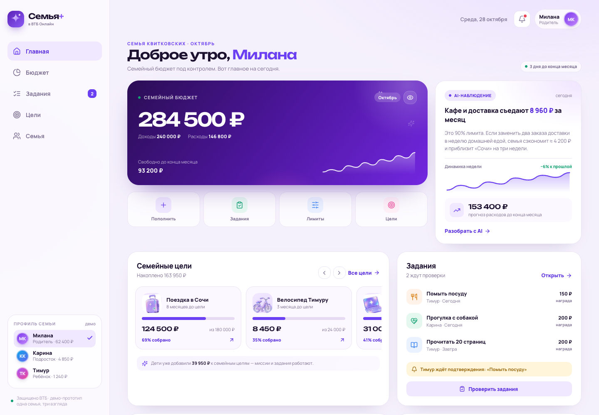
      <br><sub>Родитель · семейный бюджет, AI-инсайты и задания</sub>
    </td>
    <td width="38%" align="center">
      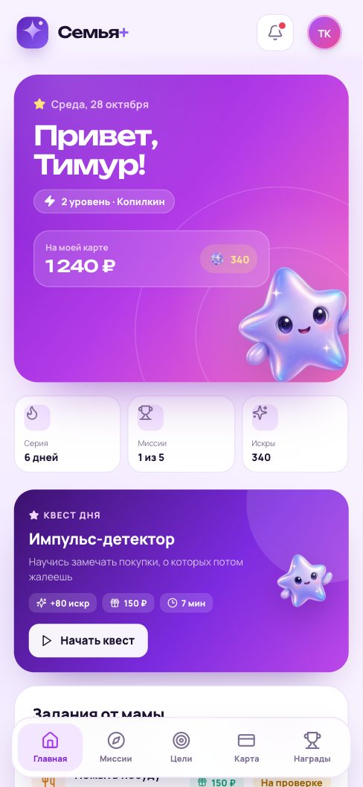
      <br><sub>Ребёнок · игровой режим, уровень и квест дня</sub>
    </td>
  </tr>
  <tr>
    <td align="center">
      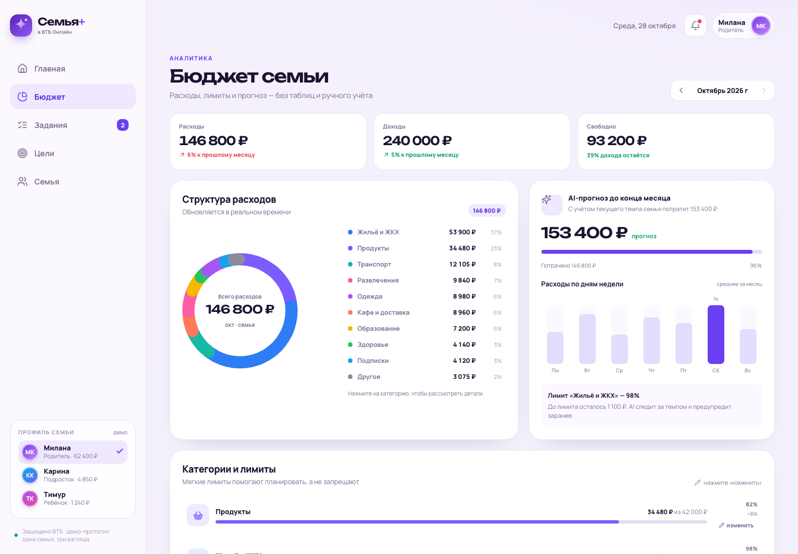
      <br><sub>Бюджет · структура расходов и прогноз</sub>
    </td>
    <td align="center">
      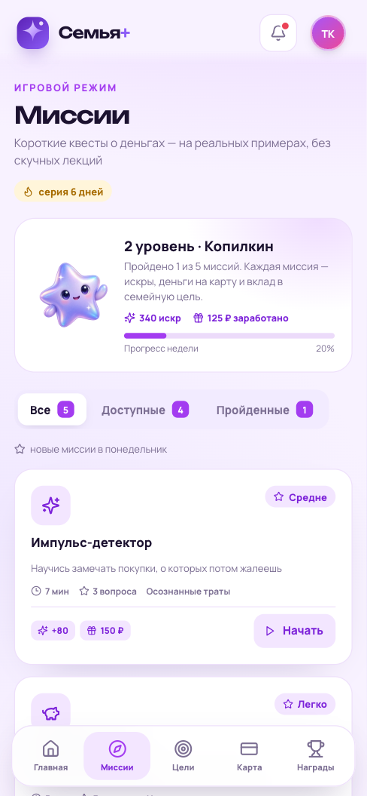
      <br><sub>Миссии · обучение на реальных действиях</sub>
    </td>
  </tr>
</table>

<table>
  <tr>
    <td width="25%" align="center">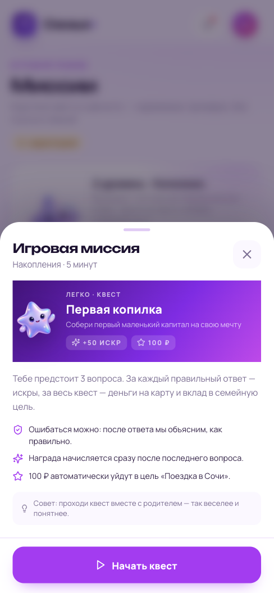<br><sub>Квест с разбором ответов</sub></td>
    <td width="25%" align="center">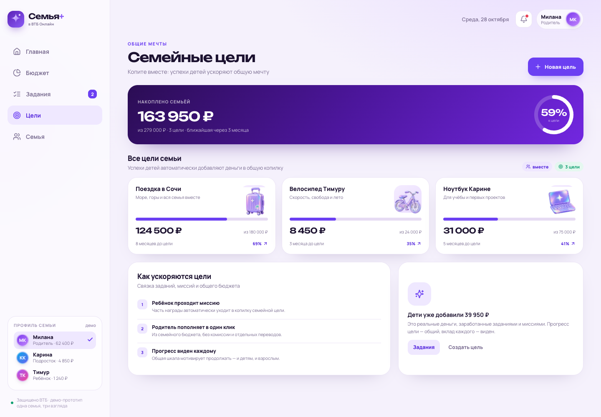<br><sub>Общие цели семьи</sub></td>
    <td width="25%" align="center">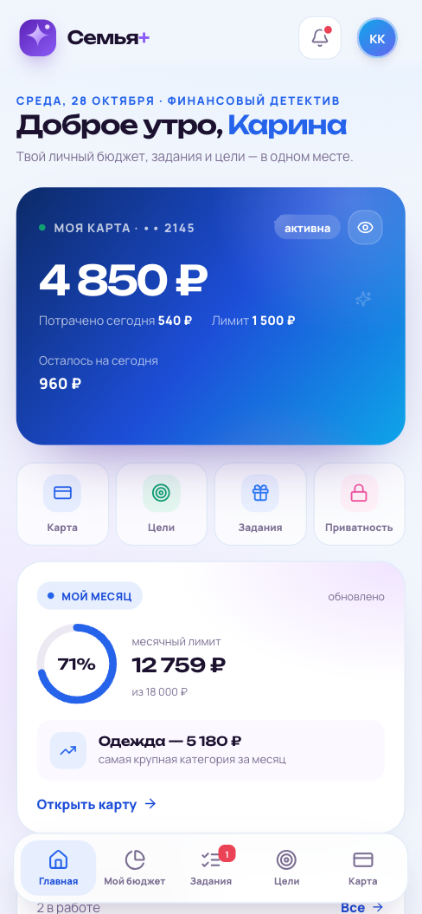<br><sub>Личный бюджет подростка</sub></td>
    <td width="25%" align="center">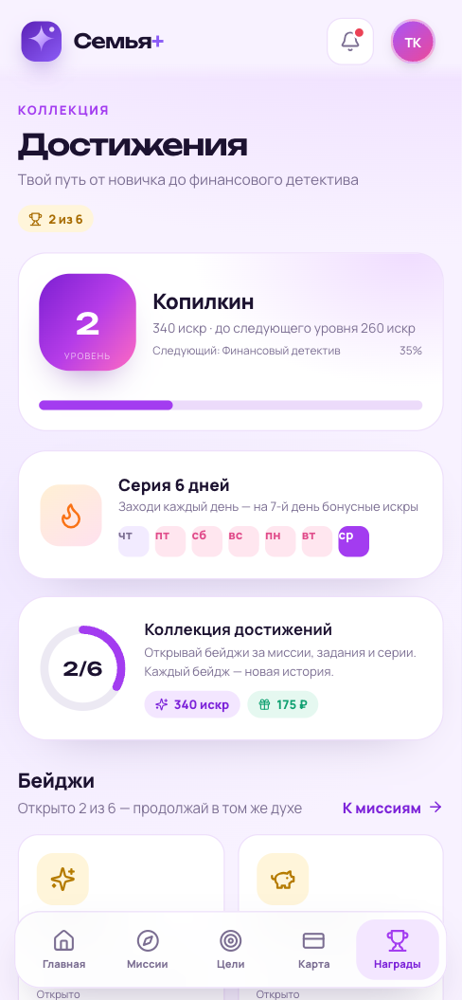<br><sub>Уровни и достижения</sub></td>
  </tr>
</table>

<table>
  <tr>
    <td width="25%" align="center">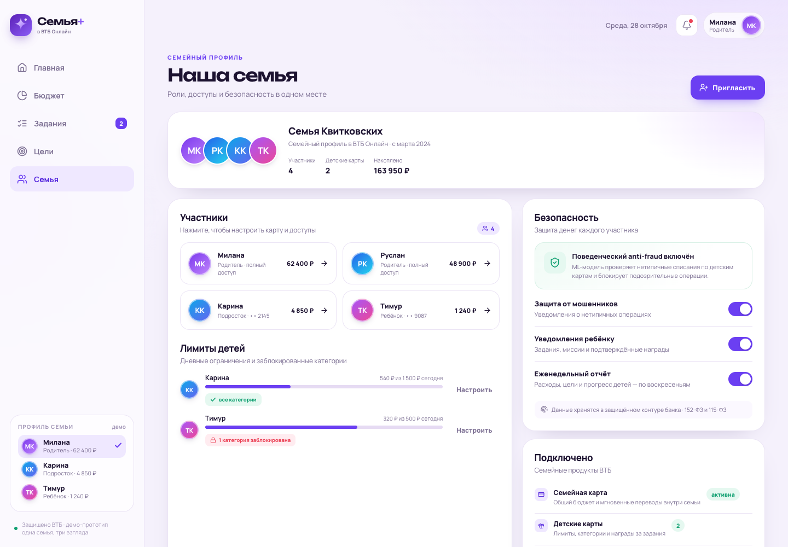<br><sub>Участники, лимиты и безопасность</sub></td>
    <td width="25%" align="center">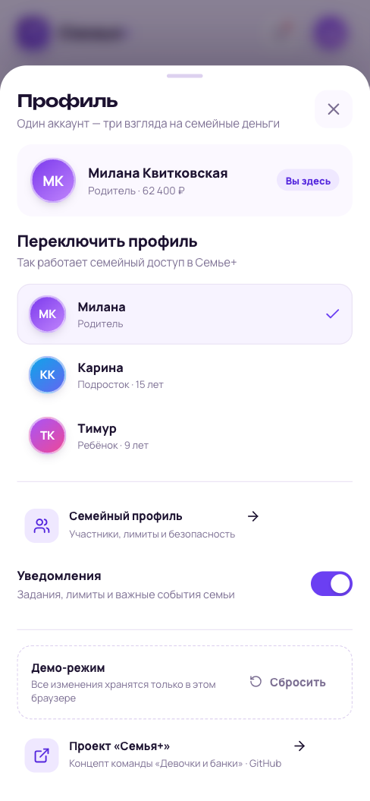<br><sub>Переключение ролей</sub></td>
    <td width="25%" align="center">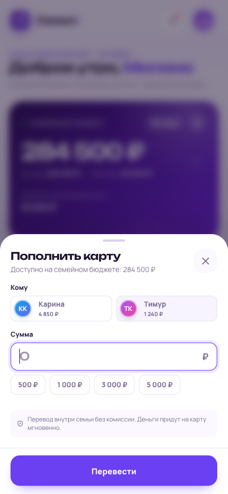<br><sub>Перевод внутри семьи</sub></td>
    <td width="25%" align="center">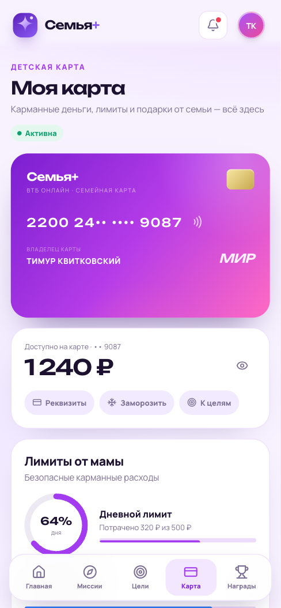<br><sub>Карта и лимиты</sub></td>
  </tr>
</table>

## Стек

| Слой | Технология |
|---|---|
| UI | React 19, TypeScript |
| Сборка | Vite |
| Стили | Собственная дизайн-система на CSS, адаптив, reduced motion |
| Иконки | Lucide React |
| Шрифты | Unbounded + Manrope (self-hosted через Fontsource) |
| Графики | SVG-компоненты без тяжёлых библиотек |
| Состояние | React Context + useReducer, синхронизация с localStorage |
| Деплой | GitHub Pages (ветка `gh-pages`) |
| Ассеты | 3D-иллюстрации и маскот сгенерированы для концепта |

## Локальный запуск

Нужен Node.js 20+ или Bun.

```bash
bun install
bun run dev
```

Приложение откроется на `http://localhost:5173`.

```bash
bun run build      # typecheck + production build
bun run preview    # локальный просмотр production-сборки
```

## Структура проекта

```text
src/
  App.tsx                 # оболочка, навигация по ролям, hash-роутинг
  store.tsx               # состояние демо, reducer, localStorage, тосты
  data.ts                 # стартовые данные семьи и миссий
  types.ts                # модели данных
  lib.ts                  # форматирование, уровни, месяцы
  components/
    BankCard.tsx          # визуал банковской карты
    QuestModal.tsx        # прохождение миссии с квизом
    charts.tsx            # donut, sparkline, weekly bars
    common.tsx            # транзакции, цели, участники
    dialogs.tsx           # все шторки: перевод, лимиты, задания, цели
    ui.tsx                # дизайн-система и Sheet/Toasts
  screens/
    parent/               # главная, бюджет, задания, цели, семья
    kid/                  # главная, миссии, достижения
    teen/                 # главная и личный бюджет
    shared/               # задания, цели, карта
  styles.css              # токены, компоненты, адаптив
public/
  assets/                 # сгенерированные 3D-иллюстрации и иконки
docs/
  pitch.pdf               # исходная презентация проекта
  screenshots/            # скриншоты для README
```

## Архитектура: что заложено под продакшен

В прототипе нет бэкенда — это осознанное ограничение демо. Для реального продукта логика раскладывается на сервисы внутри защищённого контура банка:

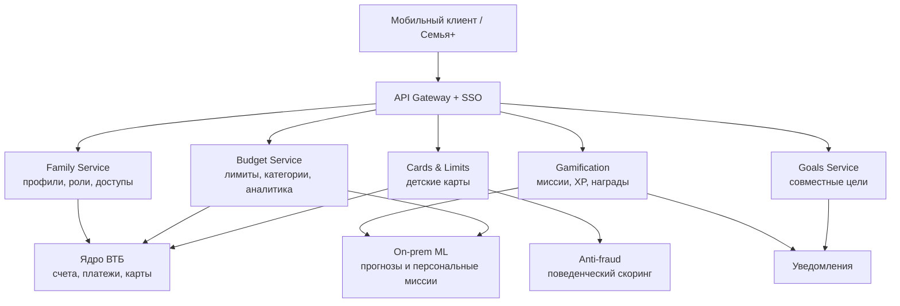

Ключевые решения для сложных частей:

- **Единый семейный профиль.** Роли `parent / teen / kid`, гранулярные права на просмотр и управление. Проверка прав — на сервере, а не только в UI.
- **Лимиты и заморозка карт.** Резервирование лимитов в транзакционном сервисе, идемпотентные команды, аудит действий родителя и ребёнка. Frontend не получает полный номер карты и CVV.
- **Приватность подростка.** Флаг приватности хранится в профиле и применяется на уровне API: родитель получает агрегаты и факт скрытых операций, но не детали.
- **Геймификация.** Миссии, XP и награды — отдельный сервис с идемпотентной выдачей. Награда не может быть начислена дважды; квесты подбираются ML по возрасту и паттернам трат.
- **AI и anti-fraud.** On-prem модели анализируют агрегированные данные, прогнозируют расходы и подсвечивают аномалии. В прототипе инсайты рассчитаны правилами на клиенте.
- **Комплаенс.** 152-ФЗ и 115-ФЗ, минимизация данных, хранение в контуре банка, разделение ролей, журналирование доступа, согласия на обработку данных ребёнка.
- **Надёжность.** Для денежных операций — идемпотентность, транзакции, компенсации, лимиты и явные состояния ошибок; для некритичной геймификации — деградация без влияния на платежи.

## Продуктовая рамка из презентации

| Метрика | Значение |
|---|---|
| TAM | ~16 млн семей с детьми 7–17 лет в РФ |
| SAM | ~3 млн семей — активные клиенты ВТБ |
| SOM на пилоте и первом году | 3% от SAM — 90 000 семей |
| Цель по продуктам на семью | 1,5 → 2,5 |
| Цель по retention | +20 п.п. |
| Семьи с хаотичным учётом расходов | более 70% |
| Родители против отдельных приложений | 84% |
| Потенциальная потеря семейного дохода | до 15% |

## Команда

| Участник | Роль |
|---|---|
| **Квитковская Милана Владимировна** | Product / Project-менеджер: стратегия, метрики, пилот, коммуникация с банком |
| **Гарифуллина Диана Фаниловна** | Backend-разработчик: API, интеграция с ядром, безопасность |
| **Кулаева Карина Валерьевна** | Frontend / UI-UX: интерфейсы родителя и ребёнка, прототип |
| **Сибагатуллина Лиана Наилевна** | ML/AI + аналитик: персонализация миссий, аналитика, финмодель |

## Деплой на GitHub Pages

Production-сборка публикуется в ветку `gh-pages`:

```bash
bun run deploy
```

В настройках репозитория: **Settings → Pages → Build and deployment → Deploy from a branch → `gh-pages` / root**.

Текущий адрес демо: **https://ofrys-tech.github.io/semya-plus/**

## Ограничения демо и следующие шаги

- Все данные вымышлены и хранятся локально в браузере; перезагрузка страницы сохраняет изменения, сброс — возвращает исходное состояние.
- Нет реальной аутентификации, платёжного ядра, push-уведомлений и серверных ML-моделей.
- AI-рекомендации в прототипе — детерминированные правила, а не обученная модель.
- Следующий шаг: вынести состояние в API, подключить песочницу банка, добавить SSO и e2e-тесты на денежные сценарии, затем провести пилот на ограниченной выборке семей.
- Товарные знаки и бренд ВТБ принадлежат их правообладателю; проект не является официальным продуктом банка.

---

<p align="center">
  Сделано студентами Уфимского филиала для кейса «Семья» · 2026
</p>
